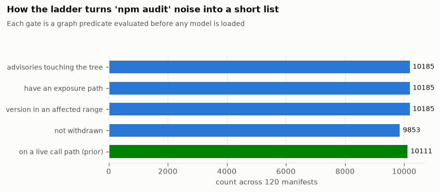
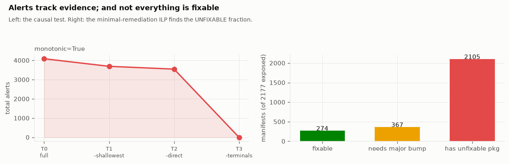
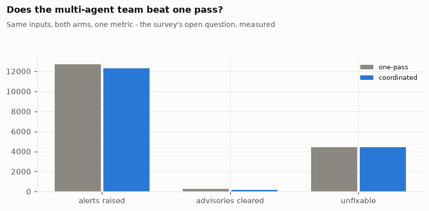
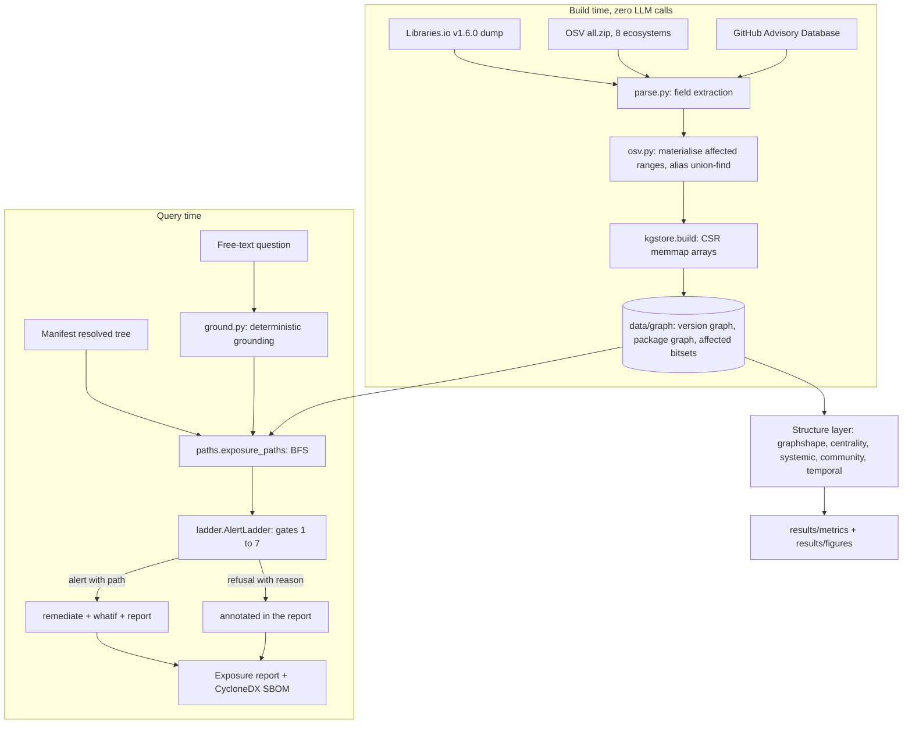

# Architecture

This document describes the `scgraph` pipeline: the seven layers, the modules of each
layer, the compressed-sparse-row graph store, version resolution, the seven-gate alert
ladder, exposure-path traversal, remediation as constrained optimisation, and the system
layer. A data-flow diagram is at the end.

The engine has 25 Python modules in [`src/scgraph/`](../src/scgraph). The package import
needs only NumPy, PyArrow, SciPy, scikit-learn, and the standard library. The model layer
(`embed`, `reach`, `gnn`, `judge`) imports PyTorch and Transformers only when you use it.
The model layer is optional.

---

## 1. Layers

The pipeline has seven layers. At build time, data moves down: published fields become
graph edges. At run time, a query moves through the upper layers: a question becomes a
set of proven exposure paths, or a refusal.

```
  Data          acquire, acquire_full, parse, osv        native edges, zero models
  Graph store   kgstore                                  CSR memmap graph + affected bitsets
  Structure     graphshape, centrality, systemic,        degree law, k-core, cycles,
                community, temporal                       articulation points, PageRank,
                                                          densification, communities
  Grounding     ground, paths, ladder                    text to PURL, exposure BFS,
                                                          the seven-gate alert ladder
  Remediation   remediate, report, whatif                ILP patch set, cited report,
                                                          CycloneDX SBOM, graph-edit diff
  Model layer   embed, reach, gnn, judge                  semantic relevance, reachability
  (GPU, opt.)                                             prior, node classification, judge
  System        agents, runstate                         capability graph, coordinated run,
                                                          versioned run graph, bisect
```

Support modules for all layers: `versions` (version comparison for each ecosystem and OSV
affected-range evaluation), `cvss` (CVSS v3.x and v4.0 vector to base score), and
`resolve` (declared range to concrete version, for the full corpus).

### 1.1 Data layer

**Modules:** [`acquire.py`](../src/scgraph/acquire.py),
[`acquire_full.py`](../src/scgraph/acquire_full.py),
[`parse.py`](../src/scgraph/parse.py), [`osv.py`](../src/scgraph/osv.py).

**Output:** the columnar edge tables, as Parquet, in `data/parquet/`:

| Table | Columns | Meaning |
|---|---|---|
| `packages` | `pkg_id, ecosystem, name` | Node table |
| `versions` | `ver_id, pkg_id, version, is_default, published` | Node table |
| `resolved` | `ver_id, res_ver_id` | Version to Version `RESOLVES_TO` edges (the graph for traversal) |
| `advisories` | `adv_id, osv_id, canon_id, summary, severity, withdrawn, published` | One row for each OSV record |
| `affected` | `adv_id, pkg_id, entry_json` | One row for each raw OSV `affected[]` entry |
| `affected_versions` | `adv_id, ver_id` | The concrete versions in an affected range |
| `aliases` | `osv_id, alias` | Advisory to Advisory alias pairs (CVE, GHSA, RUSTSEC, PYSEC) |

`acquire.py` gets the smoke data: the full OSV advisory feed for five ecosystems and a
small resolved dependency graph from the deps.dev API. `acquire_full.py` gets the full
data: the Libraries.io Open Data dump (Zenodo record 3626071), the OSV feed for eight
ecosystems, and a shallow clone of the GitHub Advisory Database for CWE identifiers and
CVE aliases. `parse.py` changes the raw data into the edge tables by field extraction
with `json` and `csv`. It uses no model and infers no edge. `osv.py` makes
`affected_versions`: for each advisory-package pair, the versions in the snapshot that
are in the affected range. It also builds the alias union-find, which maps each advisory
id to a canonical CVE, and the `withdrawn` mask.

### 1.2 Graph-store layer

**Module:** [`kgstore.py`](../src/scgraph/kgstore.py).

**Output:** the compressed-sparse-row (CSR) memmap store in `data/graph/`: a set of
`.npy` arrays that the process maps read-only. Refer to section 3.

### 1.3 Structure layer

**Modules:** [`graphshape.py`](../src/scgraph/graphshape.py),
[`centrality.py`](../src/scgraph/centrality.py),
[`systemic.py`](../src/scgraph/systemic.py),
[`community.py`](../src/scgraph/community.py),
[`temporal.py`](../src/scgraph/temporal.py).

**Output:** the network-science measurements in `results/metrics/` (`graph_shape.json`,
`criticality.json`, `systemic.json`, `community.json`, `graph_growth.json`,
`temporal.json`) and their figures.

Each function uses a CSR pair `(indptr, indices)`. Thus the same code runs on the smoke
sample and on the full graph of 4.46 million packages. `graphshape` calculates the degree
distribution and its power-law fit, the k-core decomposition, connected components, DAG
depth, and sampled distances. `centrality` calculates articulation points, bridges, and
sampled betweenness. `systemic` calculates reverse PageRank, blast radius, and the
single-maintainer compromise counterfactual. `community` calculates label propagation and
Newman-Girvan modularity. `temporal` builds the graph as it was at past dates. It fits the
densification law, the preferential-attachment kernel, and PageRank trajectories. Refer
to [methodology.md](methodology.md) for the methods and results.

### 1.4 Grounding layer

**Modules:** [`ground.py`](../src/scgraph/ground.py),
[`paths.py`](../src/scgraph/paths.py), [`ladder.py`](../src/scgraph/ladder.py).

**Output:** for a manifest and a question, a set of exposure paths with provenance and a
verdict for each advisory (alert, or a named refusal reason).

`ground` changes free text into graph entry points, deterministically (section 4).
`paths` does the breadth-first search that makes the exposure paths (section 6).
`ladder` applies the seven gates that decide if a path becomes an alert (section 5).

### 1.5 Remediation layer

**Modules:** [`remediate.py`](../src/scgraph/remediate.py),
[`report.py`](../src/scgraph/report.py), [`whatif.py`](../src/scgraph/whatif.py).

**Output:** a minimum set of version bumps (or a result that the tree has no fix), a
Markdown exposure report where each finding has its path, a CycloneDX SBOM with exposure
annotations for each component, and a graph diff (before and after) for each proposed
fix. Examples are in [`../results/reports/`](../results/reports) and
[`../results/sbom/`](../results/sbom).

### 1.6 Model layer (GPU, optional)

**Modules:** [`embed.py`](../src/scgraph/embed.py),
[`reach.py`](../src/scgraph/reach.py), [`gnn.py`](../src/scgraph/gnn.py),
[`judge.py`](../src/scgraph/judge.py).

**Output:** a semantic-relevance signal (does the advisory text agree with how the
package is used), a call-graph reachability verdict, a temporal node-classification
model, and a severity-band check from advisory text. The last one is only a measurement
instrument. We measure each output against independent ground truth, and we report
negative results ([evaluation.md](evaluation.md)). No model is in the alert path. The
deterministic layers make each alert. The model layer only adds notes or suppresses.

### 1.7 System layer

**Modules:** [`agents.py`](../src/scgraph/agents.py),
[`runstate.py`](../src/scgraph/runstate.py).

**Output:** a capability graph that sends each subtask to a handler for its ecosystem, a
coordinated multi-agent run to compare with the one-pass pipeline, and a versioned run
graph for dependency-graph bisect and recovery (section 8).

---

## 2. Graph construction with zero LLM calls

Each edge in the graph is a field that is already published:

| Edge | Source field |
|---|---|
| `Version --RESOLVES_TO--> Version` | A lockfile pin, or the resolver result for a manifest range |
| `Advisory --AFFECTS--> Package` and `--AFFECTS_VERSION--> Version` | OSV `affected[].ranges[].events` and `affected[].versions` |
| `Advisory --ALIAS_OF--> Advisory` | OSV `aliases` |
| `Advisory --WITHDRAWN` | OSV `withdrawn` |
| `Version --HAS_DEFAULT` | Registry "latest" pointer |
| `Version --PUBLISHED_AT` | Registry publication timestamp |

No language model extracts the graph. Thus construction scales to the full ecosystem. The
full run built a graph of **4,460,049 packages, 21,415,461 versions, 82,807,953 resolved
edges, and 285,698 advisories with 0 LLM calls**
([`run_manifest.json`](../results/run_manifest.json), field
`llm_calls_to_build_graph`).

For comparison, GraphRAG extracts a graph from text with a language-model call on each
chunk. The reported cost is approximately 33,000 US dollars in model calls for one
dataset. That cost does not scale to millions of packages. It is also not necessary here,
because the dependency and advisory data already have a structure. Language models occur
only in the optional model layer, and only for signals in natural-language text (a
package description, an advisory summary).

---

## 3. The CSR memmap graph store (`kgstore.py`)

### 3.1 Why not a graph database

A graph database such as Neo4j has no bulk edge loader. It adds relations one statement
at a time. At 10^8 to 10^9 edges and one to five milliseconds for each statement, the
load alone takes days. Also, a server process cannot expand a k-hop neighbourhood in the
microseconds that an audit loop needs.

### 3.2 Compressed sparse row

Sort all edges by source node. Then `indptr[i]` is the offset into `indices` where the
neighbour list of node `i` starts, and `indices[indptr[i]:indptr[i+1]]` is the neighbour
list of node `i`. A neighbour lookup is one array slice: `O(degree)`, with no allocation,
no inter-process communication, and no query parser. The build cost is `O(E log E)`, the
cost of the sort. Storage is `4 * (V + E)` bytes with `int32` indices.

`kgstore.build` writes these arrays as `.npy` files. `KGStore.__init__` opens them with
`mmap_mode="r"`. Thus a process maps the arrays into its address space and does not read
them. The page cache of the operating system controls which pages stay in memory.

### 3.3 The three stores

| Store | Arrays | Direction | Use |
|---|---|---|---|
| Version graph | `res_indptr / res_indices` and `rdep_indptr / rdep_indices` | Forward (`RESOLVES_TO`) and reverse (dependents) | Exposure-path BFS, blast radius |
| Package graph | `pkgdep_indptr / pkgdep_indices` and `pkgrev_indptr / pkgrev_indices` | Forward and reverse, package to package | k-core, centrality, systemic risk, communities, densification |
| Affected bitsets | `aff_adv_indptr / aff_adv_ids` | Version to advisory | "Is this version affected", `O(1)` for each version |

The package graph comes from the version graph: package A depends on package B if a
version of A resolves to a version of B (no duplicates). The full run has 6,682,795
package-level edges from the 82,807,953 version-level resolved edges. Each store has
both directions. Thus "what breaks if I bump X" is one reverse slice.

The store also has arrays for each version (`ver_pkg`, `ver_str`, `ver_default`,
`ver_published`), each package (`pkg_eco`, `pkg_name`), and each advisory (`adv_sev`,
`adv_withdrawn`, `adv_published`, `adv_summary`, `adv_canon`). It also has the alias map,
and the `canon_to_idx` and `(ecosystem, name)` lookup indices that the load builds.

### 3.4 Measured cost

From [`results/metrics/timing.json`](../results/metrics/timing.json), on the full graph:

- Build from Parquet: `osv.materialise` 27.9 s, then `kgstore.build` 140.3 s
  (approximately 2.3 minutes for the CSR store).
- Load for each process: `KGStore.__init__` 13.19 s, peak resident set 16,047 MB.
- Node-expansion probe: neighbour, dependent, and advisory lookups on a random sample of
  versions. The rate agrees with a **p50 full-audit latency of 0.02 ms** and a
  single-process **throughput of 2,546 audits each second**. One Neo4j network round trip
  takes one to five milliseconds.

---

## 4. Version resolution as constraint satisfaction (`resolve.py`)

The graph uses concrete versions, but a manifest declares *ranges* (`^1.2.0`,
`>=1.0,<2.0`, `[1.0,2.0)`). With peer dependencies and diamond conflicts, the selection
of one version for each package that satisfies all ranges is NP-complete. It encodes
Boolean satisfiability: each package version is a variable and each range is a clause.
This is why lockfiles exist: tools solve resolution one time and keep the result.

`resolve.py` implements the common subset that covers approximately 99 percent of real
manifests:

| Ecosystem | Grammar |
|---|---|
| npm, Cargo, Packagist | node-semver: `^ ~ >= <= > < =`, `,` and `\|\|`, `x` and `*` wildcards, `a - b` hyphen ranges |
| PyPI | PEP 440, with `packaging.specifiers` |
| Maven | Interval notation `[a,b)`, `(,b]`, `[a,]`, and a soft `a` |
| Go | Exact (`go.mod` requirements are concrete), or semver `>=` |

The resolver selects the highest published version that satisfies the range. It prefers
versions that are not prereleases. This agrees with the default install of npm and Cargo,
and is sufficiently near to the deps.dev resolver for a bulk graph. If the Libraries.io
row has a `resolved_version`, the resolver uses it as a lockfile pin. If no version
satisfies the range, the edge is a dangling stub. The pipeline counts these stubs. It
does not drop them silently.

[evaluation.md](evaluation.md) compares the resolver with deps.dev. When the deps.dev
version is also in the January 2020 snapshot, the two resolvers agree **97.2 percent** of
the time.

---

## 5. The seven-gate alert ladder (`ladder.py`)

The ladder changes "npm audit shows 47 items" into a short list. Each item has a path.
All other items get an explicit refusal. **Gates 1 to 6 are graph predicates. They run
before a model can run.** A refusal is not a model decision. It is an empty result from a
deterministic query.

| Gate | Condition that stops the alert | Reason |
|---|---|---|
| 1 | No part of the question grounded to an indexed package or advisory | The question named nothing in the graph |
| 2 | Grounded, but no resolved dependency path goes to an affected version | Present by name only, not connected in the resolved tree |
| 3 | No path terminal is in an affected range | Present, but at a safe version (gate 2 path construction includes this) |
| 4 | Affected only through a yanked or unpublished version | The evidence is a version that you cannot install |
| 5 | All remaining paths go through a **withdrawn** advisory | The advisory was retracted upstream |
| 6 | As-of date: no advisory was published on or before the release date of the shipped version | The advisory was not known at that time |
| 7 | Present, but the vulnerable symbol is not on a live call path | Annotate for review, do not alert |

Only gate 7 can use the model layer (a static call-graph verdict, or the structural
reachability prior). Gate 7 is optional. It is off if you do not supply a reachability
map. Between gates 6 and 7 there is also a severity floor (`min_severity`, default 0.0).

`AlertLadder.evaluate(groundings, paths, reachability=None)` gives a `Verdict` with a
boolean `alert`, a `reason` string (`not_grounded`, `no_exposure_path`,
`only_noninstallable_evidence`, `only_withdrawn_advisories`, `not_knowable_as_of_date`,
`below_severity_floor`, `present_but_unreachable`, or `exposed`), and the remaining paths
sorted by severity (high first) and then depth (low first). `audit_manifest` applies the
ladder to each advisory that touches the resolved tree of a manifest. It gives the full
classified report.

An ablation tests the causal behaviour of the ladder. When the affected terminals are
removed from the graph in increasing tiers, the alert count must decrease to zero at each
step. The full run gives **4,084 to 3,691 to 3,545 to 0**
([`exp_ablation.json`](../results/metrics/exp_ablation.json)).



---

## 6. Exposure paths (`paths.py`)

The simple question is "does my manifest list a vulnerable package". The correct question
is "is there a path in the resolved tree from my application to an affected version". The
evidence *is* that path. `exposure_paths(store, root_vid, max_depth, max_paths)` does a
breadth-first search from the manifest root on the forward `RESOLVES_TO` store. When a
visited version is affected by an advisory, it makes an `ExposurePath` with: the
canonical advisory id, the OSV id, the CVSS base score, the `withdrawn` flag, the hop
version ids from root to terminal, the depth, the terminal package string, and the
advisory publication date.

There are two classes:

- **DIRECT**: the affected version is at depth 1, a direct dependency of the root.
- **TRANSITIVE**: the affected version is deeper. The path shows each hop. A resolver
  made each hop as a `RESOLVES_TO` edge.

The function removes duplicate paths by `(advisory, terminal)`. It sorts them by depth
(low first) and then by severity (high first), because an engineer acts on a shallow
high-severity path first. The reverse direction (`blast_radius`) uses the reverse store
to answer "if we must yank or patch X, which builds break". It has a hop limit and a node
budget, because a hub such as `lodash` has millions of transitive dependents, and an
exact count above some hundred thousand does not help.

An example in [`results/reports/report_00.md`](../results/reports/report_00.md) follows a
Spring Boot 2.1.7 project to Log4Shell:

```
[CVE-2021-44228  cvss=10.0] cc.catalysts.boot:cat-boot-thymeleaf3@0.2.27
  -> org.springframework.boot:spring-boot-starter@2.1.7.RELEASE
  -> org.springframework.boot:spring-boot@2.1.7.RELEASE
  -> org.apache.logging.log4j:log4j-core@2.12.1
```

---

## 7. Remediation as optimisation (`remediate.py`)

For the exposure paths of a manifest, find the smallest set of version bumps that clears
all advisories. A bump must not go into a new affected range or across a major version.
This is weighted set cover, which is NP-hard. Thus we report two solvers.

**`greedy_fix`** selects, for each affected package, the lowest clean version (not a
prerelease) that is equal to or higher than the current version. It always stops, it
scales, and it gives an upper limit on the bump count. Most tools do this.

**`ilp_fix`** is the exact formulation. Binary variables `y[p,v]` select version `v` of
package `p`. One-hot constraints select one version for each package. A hard linear
constraint makes the selected version free of advisories. The objective is
`number of bumps + lambda * number of major bumps`. `scipy.optimize.milp` (the HiGHS
branch-and-bound solver) solves it. The ILP shows what greedy does not show: sometimes a
fix of A forces a downgrade of B, and no assignment satisfies all constraints. Then the
tree has **no fix** without a major bump or a pinned exception.

Prerelease filters are important. `_clean_versions` removes alpha, beta, rc, dev, and
SNAPSHOT versions, if the replaced version is not a prerelease. Without this filter, the
greedy fixer recommends versions such as `jetty 10.0.0-alpha0`. This increases the
"needs a major bump" and "advisories introduced" counts. (This was a real bug. Refer to
[evaluation.md](evaluation.md).)

Full-run result ([`exp_remediation.json`](../results/metrics/exp_remediation.json)): of
**2,177 exposed manifests, 641 have a remediation, 2,105 contain a package with no safe
fix, and 367 need a major bump.**

### 7.1 A remediation is a graph edit (`whatif.py`)

A proposed bump edits the graph: each `RESOLVES_TO` edge that pointed at a version of the
bumped package now points at the new version. To evaluate the edit, run the queries on
the two graphs. `diff_manifest` applies the bump set as an in-memory overlay (a dict of
redirected edge targets that the walk reads). Thus a what-if costs `O(affected subtree)`,
not a graph rebuild. It reports advisories cleared, advisories **introduced** (the new
version is in the range of a different advisory), the change in tree depth, and the
change in total CVSS mass. `fix_ripple` counts how many other manifest roots contain the
bumped package. This is the blast radius of the fix in a shared lockfile.

Full-run result ([`whatif_portfolio.json`](../results/metrics/whatif_portfolio.json)):
across the 641 manifests with a fix, the greedy fixes clear 2,334 advisories but
**introduce 317**. They move total CVSS mass from 139,316.6 to 128,519.5. **28
manifests become worse.**



---

## 8. The system layer (`agents.py`, `runstate.py`)

The one-pass pipeline is `ground -> traverse -> gate -> remediate`, and a refusal is
final. The system layer adds three graph views. Thus we can measure if coordination
helps.

**Capability graph (`agents.CapabilityGraph`).** Typed edges from each agent to its
ecosystems, its tools, and its measured reliability for each task class. To send a Go
module to `Resolver.go` is a graph query: `route(task, ecosystem)` gives the agent with
the highest reliability for that pair. The agents are resolvers for each ecosystem, an
advisory matcher, reachability analysts for each ecosystem, a license auditor, a patch
proposer, a build verifier, an escalator, and a reporter.

**Coordinated and one-pass runs (`run_one_pass`, `run_coordinated`).** The coordinated
run adds a reachability analyst that gates the patch proposer (patch only items on a live
path), a build verifier that can send a breaking major bump back for refinement, and an
escalator for items with no fix. `PatchProposer` and `BuildVerifier` are **separate nodes
by design**. Thus the agent that writes the patch does not also grade it. Each hand-off
is an edge in a `CommGraph`. The message "only 3 of 11 advisories are on a live path" is
marked decisive.

Full-run result ([`exp_coordination.json`](../results/metrics/exp_coordination.json)):
one-pass gives 12,717 alerts and clears 273 advisories. Coordinated gives 12,316 alerts
and clears 178. Coordination gives less coverage for a small increase in precision, with
no clear win. Thus the agent loop is a measured ablation, not the architecture.



**Versioned run graph (`runstate.RunGraph`).** An append-only event log and a status for
each (manifest, package) pair, with provenance. A proposed bump is a tentative write.
`BuildVerifier` commits it. This is an explicit boundary: proposal, validation, commit.

**Dependency-graph bisect (`runstate.bisect_build`).** A build fails after a bump of
`{A, B, C, D}` together. Which bump is the cause? Leave-one-out over the bump set, with a
build check each time, finds the cause in `O(n)` build runs. If no single removal fixes
the build, the routine reduces the set to a minimum interacting subset. This is git
bisect on the dependency-graph diff, not on the file diff. It is possible because the run
graph keeps the resolution before and after the bump.

**Recovery (`runstate.recover`).** For the decisive bump: try the next clean version that
is not a major bump, or pin with a recorded exception, or escalate. Each step records a
recovery boundary. Thus you can run it again.

---

## 9. Data-flow diagram

### Build time

```
  Libraries.io v1.6.0 dump          OSV all.zip (8 ecosystems)     GitHub Advisory DB
  (Zenodo 3626071, 24.89 GB)        (live each run)                (CWE, CVE aliases)
          |                                 |                              |
          v                                 v                              v
  +-------------------------------------------------------------------------------+
  |  acquire_full.py  /  acquire.py     (download, verify md5, keep zips as zips) |
  +-------------------------------------------------------------------------------+
          |
          v
  +-------------------------------------------------------------------------------+
  |  parse.py     field extraction, no model                                     |
  |               -> packages, versions, resolved, advisories, affected, aliases |
  +-------------------------------------------------------------------------------+
          |
          v
  +-------------------------------------------------------------------------------+
  |  osv.py       materialise affected ranges -> affected_versions bitsets        |
  |               alias union-find -> canonical CVE ; withdrawn mask              |
  +-------------------------------------------------------------------------------+
          |
          v
  +-------------------------------------------------------------------------------+
  |  kgstore.build   sort edges by source -> CSR .npy arrays (memmap)            |
  |     version graph (fwd + rev) | package graph (fwd + rev) | affected bitsets |
  +-------------------------------------------------------------------------------+
          |
          v
     data/graph/*.npy    (about 2 GB, rebuilds in ~2.3 min)
```

### Query time

```
  "are we exposed to the log4j thing?"        a manifest (resolved tree root)
                 |                                        |
                 v                                        |
        +-----------------+                               |
        |  ground.py      |  purl -> advisory id -> incident alias -> exact name
        |  (no model)     |  -> normalised name ; index only real packages
        +-----------------+                               |
                 |  package / advisory entry points       |
                 v                                        v
        +-----------------------------------------------------------+
        |  paths.exposure_paths   BFS the resolved tree             |
        |  emit ExposurePath per (advisory, affected terminal)      |
        +-----------------------------------------------------------+
                 |  DIRECT / TRANSITIVE paths, each provenanced
                 v
        +-----------------------------------------------------------+
        |  ladder.AlertLadder    gate 1..6 (pure graph predicates)  |
        |  then severity floor, then gate 7 (optional, model layer) |
        +-----------------------------------------------------------+
                 |  alerts (with path)          refusals (with reason)
                 v
        +-----------------------------------------------------------+
        |  remediate.greedy_fix / ilp_fix   minimal safe bump set   |
        |  whatif.diff_manifest            cleared vs introduced    |
        |  report.exposure_report / to_cyclonedx   the deliverable  |
        +-----------------------------------------------------------+
                 |
                 v
     exposure report (Markdown, every finding carries its path) + CycloneDX SBOM
```

### Flowchart



---

## 10. How the layers map to the survey

The pipeline uses the model in *Graph Engineering in the Era of LLM Agents*
(arXiv:2608.21156v2):

| Survey concept | `scgraph` implementation |
|---|---|
| Deterministic grounding identifier | PURL, with CPE and OSV aliases as bridges (`ground.py`) |
| Hard schema, provable violations | OSV affected ranges and the graph predicates of the alert ladder |
| Task Organization (section 4.2) | The audit split into (manifest, ecosystem) units; exposure-path BFS |
| Agent Coordination (section 4.3) | The capability graph, fan-out to fan-in, `PatchProposer` separate from `BuildVerifier` (`agents.py`) |
| Runtime State Management (section 4.4) | The versioned run graph, proposal to commit, dependency-graph bisect (`runstate.py`) |
| System Evolution (section 4.5) | The org ledger of chronic false positives and green upgrade recipes (`agents.py`, staged) |

Refer to [methodology.md](methodology.md) for the theory and references of each
structural analysis, and to [results.md](results.md) for the full-run results.
