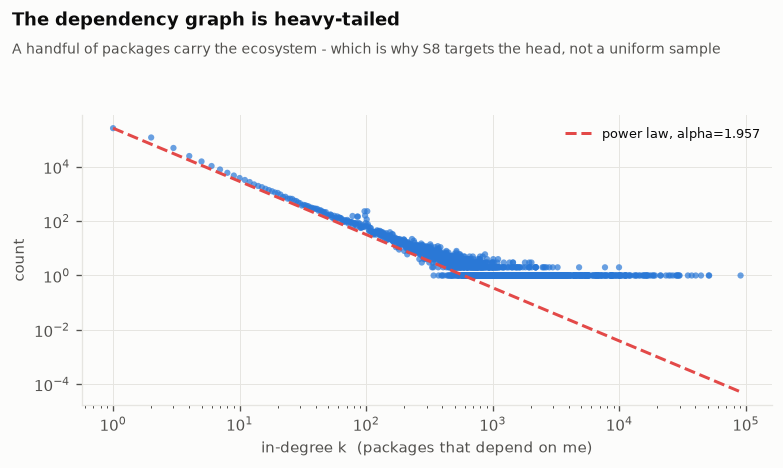
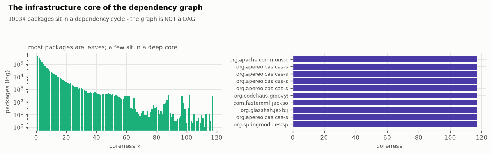
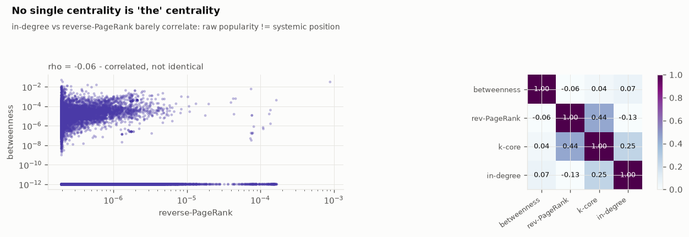
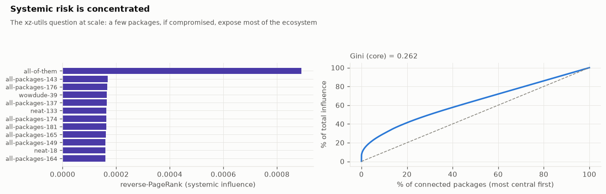
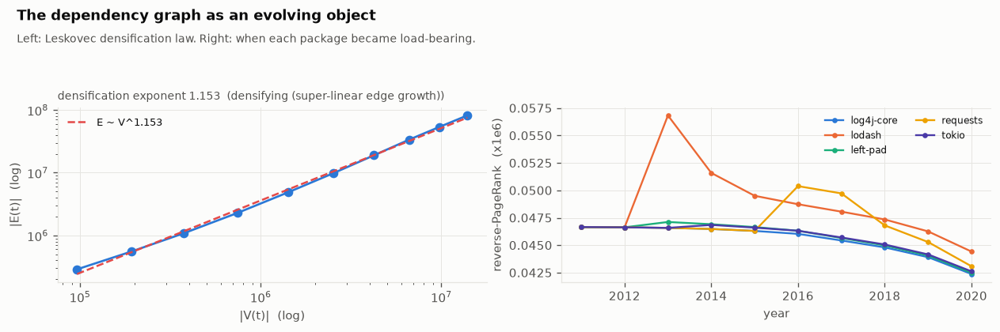
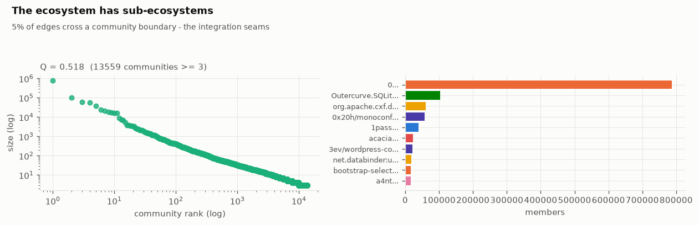
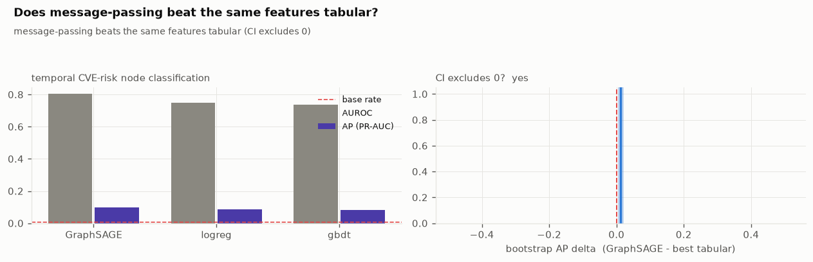
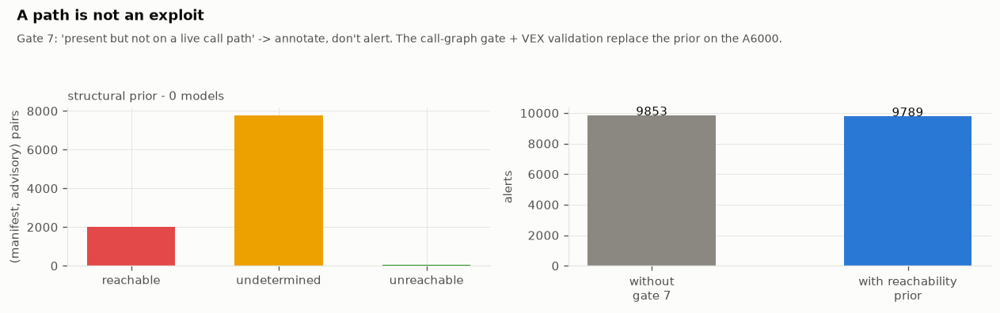

# Methodology

This document gives each graph and statistical method of the pipeline: what it
calculates, how the pipeline calculates it, the reference, and the full-run result (8
ecosystems: 4,460,049 packages, 21,415,461 versions, 82,807,953 resolved edges, 285,698
advisories). The theory follows the sections of the
[notebook](../notebooks/supply_chain_graph_engineering.ipynb). The numbers come from
[`../results/`](../results).

Scope: the structural analyses use the **package-level graph**. In this graph, package A
points to package B if a version of A resolves to a version of B. It has 6,682,795 edges,
made from the 82,807,953 version-level `RESOLVES_TO` edges. The temporal analyses use the
version-level graph, because it has publication dates.

---

## 1. Degree distribution and the power-law test

**Calculation.** The in-degree of a package is the number of packages that depend on it.
The out-degree is the number of packages that it declares. The question: does the
in-degree distribution have a heavy tail, and does it follow a power law
`P(k) proportional to k^(-alpha)`? If yes, a small number of packages carry the
ecosystem, and an analysis of the head gives more value than a uniform sample.

**Method.** `graphshape.degree_stats` gives the mean, median, p90, p99, max, and zero
fraction for the two directions. `graphshape.powerlaw_mle` fits the exponent with the
Clauset-Shalizi-Newman maximum-likelihood estimator for a discrete power law with a lower
cutoff `xmin`:

```
alpha = 1 + n / sum_i ln( k_i / (xmin - 0.5) )     over k_i >= xmin
```

It also gives a Kolmogorov-Smirnov (KS) distance to the fitted CDF. The KS number alone
cannot tell if a power law is the correct model. Thus `graphshape.powerlaw_gof` runs the
Clauset-Shalizi-Newman bootstrapped goodness-of-fit test. It makes many synthetic
datasets of the same size from the fitted power law, fits each dataset, and calculates
the fraction with a KS distance equal to or more than the observed KS. That fraction is
the p-value. If `p >= 0.1`, a power law is possible. If `p < 0.1`, the test rejects it.
The discrete power-law CDF uses the Hurwitz zeta function (`scipy.special.zeta`).

**Reference.** A. Clauset, C. R. Shalizi, M. E. J. Newman, "Power-Law Distributions in
Empirical Data", SIAM Review 51(4), 2009, section 4.

**Full-run result.** In-degree `alpha = 1.957` (`xmin = 2`, tail of 285,674 packages),
KS 0.376. The bootstrapped test gives corrected KS 0.0479 and **p = 0.0 over 300
bootstrap samples: the test rejects the power law**. Out-degree `alpha = 1.918`, KS
0.0874, `p = 0.0`, also rejected
([`powerlaw_gof.json`](../results/metrics/powerlaw_gof.json)). The distribution has a
heavy tail (in-degree mean 1.50, max 90,850; no package depends on 87.7 percent of
packages), but it is not scale-free. At a tail size of 285,674, the strict test rejects
almost all real data. The correct result is: heavy tail, the head is dominant, and a
lognormal or a power law with an exponential cutoff fits better. "Scale-free" is not a
correct name for this graph.



---

## 2. k-core decomposition

**Calculation.** The coreness of a node is the largest `k` for which the node is in a
subgraph where each node has a degree of `k` or more. High coreness shows deep
infrastructure. Coreness 0 or 1 shows a leaf. The k-core removes the leaves to show the
structural spine of the graph.

**Method.** `graphshape.kcore` implements Batagelj-Zaversnik bucket peeling. It sorts the
nodes by current degree, removes the node with the minimum degree, decreases the degree
of its neighbours, and records the degree at which it removed each node. The cost is
`O(E)`. Above one million nodes, the Python peel is slow. Thus the module uses the C
implementation of `python-igraph` (`coreness(mode="all")`). It gives the same result
approximately 100 times faster.

**Reference.** V. Batagelj, M. Zaversnik, "An O(m) Algorithm for Cores Decomposition of
Networks", 2003. S. B. Seidman, "Network structure and minimum degree", Social Networks
5, 1983.

**Full-run result.** k-core runs in 3.8 s on the package graph
([`timing.json`](../results/metrics/timing.json)). Most packages are leaves. A small
dense core carries the ecosystem. The temporal GraphSAGE task (section 9) uses only the
2-core of the giant component (916,738 packages), because degree-1 nodes have no
neighbourhood signal.



---

## 3. Connected components, DAG depth, cycles

**Calculation.** Weakly connected components (edge direction is not used) show how much
the ecosystem is split. Strongly connected components with a size of more than 1 **are**
dependency cycles. A resolver cannot make a cycle, but a declared graph can have cycles,
because npm permits circular `require`. The longest path in the acyclic condensation is
the maximum traversal depth.

**Method.** `graphshape.components` uses `scipy.sparse.csgraph`
(`connected_components`) for the weak and strong variants. `graphshape.dag_depth` does a
topological longest-path dynamic program, `O(V + E)`, and gives the level sizes.
`graphshape.sample_distances` runs BFS from a sample of sources to estimate the effective
diameter. The exact diameter costs `O(VE)`, which is too much here. The effective
diameter is the 90th percentile of the sampled shortest-path lengths.

**Reference.** R. E. Tarjan, "Depth-first search and linear graph algorithms", SIAM
J. Comput. 1(2), 1972. The effective diameter follows Leskovec-Kleinberg-Faloutsos
(section 7).

**Full-run result** ([`graph_shape.json`](../results/metrics/graph_shape.json)):

- Weakly connected components: 3,005,952. The largest has **1,219,685 packages, 27.3
  percent of the graph**.
- Strongly connected components larger than 1: **2,366, with 10,034 packages**. The
  dependency graph is **not a DAG**.
- Longest dependency chain: **28 hops**. Effective diameter (p90 of sampled shortest
  paths): 16. Mean sampled path length: 9.9.

---

## 4. Articulation points and bridges

**Calculation.** An articulation point (cut vertex) is a node that increases the number of
connected components when you remove it. No path goes around it. Thus it is a single
point of failure. A bridge is the edge version: an edge with no alternative route, a
dependency with no redundancy in the ecosystem. These measures use only topology.

**Method.** `centrality.articulation_points_and_bridges` runs Hopcroft-Tarjan on the
undirected package graph. One depth-first search records `disc[v]` (discovery time) and
`low[v]` (the earliest discovered node that the subtree of `v` can reach). A non-root `v`
is an articulation point if it has a child `w` with `low[w] >= disc[v]`. The root is an
articulation point if it has two or more DFS children. An edge `(u, v)` is a bridge if
`low[v] > disc[u]`. The DFS is **iterative with an explicit stack**, because the graph is
deeper than the Python recursion limit. Above 500,000 nodes, the module uses the C
implementation of `python-igraph`.

**Reference.** J. Hopcroft, R. Tarjan, "Efficient algorithms for graph manipulation",
Communications of the ACM 16(6), 1973.

**Full-run result** ([`criticality.json`](../results/metrics/criticality.json)):
**88,273 articulation points (2.0 percent of packages) and 386,554 bridges**. The cut
vertices with the most dependents are the packages that an engineer expects: `lodash`,
`react`, `chalk`, `request`, `commander`, `express`, `react-dom`, `moment`, `fs-extra`,
`debug`. The detection runs in 7.5 s on the full package graph.

---

## 5. Betweenness centrality with a sample bound

**Calculation.** The betweenness of a node is the fraction of all shortest paths that go
through it: how much traffic goes through this package. It finds different packages than
PageRank or in-degree.

**Method.** Exact betweenness (Brandes) costs `O(VE)`, approximately 10^15 operations for
this graph. This is too much. `centrality.betweenness_sampled` runs Brandes accumulation
from `K` sampled source pivots and multiplies by `n / K`. The number of pivots for a
uniform approximation is the **Riondato-Kornaropoulos** bound:

```
K >= (c / eps^2) * ( floor(log2(VD - 2)) + 1 + ln(1/delta) )
```

`VD` is the vertex diameter, `eps` is the additive error, `delta` is the failure
probability, and `c` is a small constant. This gives an `eps`-approximation of the
betweenness of *each* node with probability `1 - delta`. The implementation also has a
BFS hop limit (paths longer than approximately eight hops have almost no betweenness
mass and cost the most) and a pivot pool, to keep pivots on the spine. For the full run
there is a hard degree limit and a wall-clock timeout with a fallback. An early version
of the limit did not stop on a dense real cluster (refer to
[evaluation.md](evaluation.md), bug list).

**Reference.** U. Brandes, "A Faster Algorithm for Betweenness Centrality", Journal of
Mathematical Sociology 25(2), 2001. M. Riondato, E. M. Kornaropoulos, "Fast approximation
of betweenness centrality through sampling", WSDM 2014.

**Full-run result.** Sampled Brandes with 60 pivots on the 20-core (8,000 nodes). The
Riondato-Kornaropoulos bound for the target error was 3,061 pivots. The run reached its
150-second budget and used the smaller sample (166 s of work,
[`criticality.json`](../results/metrics/criticality.json), `timing.json`). The Spearman
rank correlation between betweenness and reverse PageRank over connected packages is
**-0.06**. Between in-degree and reverse PageRank it is **-0.13**. No single centrality
is "the" centrality. Popularity has a small negative correlation with systemic position.



---

## 6. Reverse PageRank, blast radius, and the single-maintainer counterfactual

**Calculation.** This is the xz-utils question for the full graph: if one package or one
maintainer is compromised, how much of the ecosystem is exposed? There are three views.

- **Reverse PageRank.** PageRank on the reversed dependency graph. Probability mass moves
  to the packages that many packages use. The stationary distribution shows how much
  load each package carries.
- **Blast radius.** For each package, the number of application packages that contain it
  in their transitive dependency closure.
- **Single-maintainer compromise.** Mark a package as malicious, move "exposed" along
  reverse edges, and count the application packages that it reaches. This is the upper
  limit of a supply-chain attack through that package.

**Method.** `systemic.pagerank_rev` does power iteration on the reverse CSR:
approximately 40 sparse matrix-vector products, each `O(E)`, damping 0.85, with
redistribution of dangling mass. `systemic.blast_radius` uses breadth-first search
(`scipy.sparse.csgraph`) from the application packages (packages with dependencies but no
dependents). `systemic.compromise_sim` is a reverse-reachability flood from the victim.
The **Gini coefficient** shows the concentration of the PageRank vector: 0 (all packages
are equally central) to 1 (one package has all influence). The pipeline calculates it
only over the connected core. The corpus also has approximately 200,000 isolated nodes
(packages named only by malware advisories, with no edges). These nodes make global
statistics flat.

**Reference.** L. Page, S. Brin, R. Motwani, T. Winograd, "The PageRank Citation Ranking:
Bringing Order to the Web", Stanford technical report, 1999. C. Gini, "Variabilita e
mutabilita", 1912.

**Full-run result** ([`systemic.json`](../results/metrics/systemic.json)):
**reverse-PageRank Gini over the connected core is 0.262**. Reverse PageRank runs in
4.3 s. The top of the raw ranking is npm spam packages (`all-of-them`,
`all-packages-143`, `wowdude-39`, `neat-133`) that depend on all packages. The analysis
marks this as an artefact, not a real result. For this reason, the criticality analysis
also uses articulation points and bridges.



---

## 7. Laws of graph growth: densification and preferential attachment

**Calculation.** Libraries.io gives each version a publication date. Give each
`RESOLVES_TO` edge the publication date of its source version (the edge started when that
version was released). Then the graph has a time dimension. There are two classical
results.

- **Densification power law.** `|E(t)|` grows as `|V(t)|^a`. If `a = 1`, the average
  degree is constant. If `a > 1`, the graph becomes denser: each new group of packages
  depends on more existing packages than the group before. The pipeline fits `a` with
  ordinary least squares on `log|V|` against `log|E|` across yearly snapshots.
- **Preferential attachment.** Freeze the graph at year `Y`. For each edge that occurs
  after `Y`, record the in-degree at `Y` of its target node. The attachment kernel is
  `P(attach to a node of in-degree k)` divided by `P(an existing node has in-degree k)`.
  A linear kernel (slope near 1) is the Barabasi-Albert "rich get richer" model. A
  super-linear kernel is "winner takes all".

**Method.** `temporal.edge_times` gets the source-version dates. `temporal.snapshots`
builds a CSR for each yearly prefix of the time-sorted edge list (one sort, then `k`
cheap CSR builds). `temporal.densification_law` does the OLS fit.
`temporal.attachment_kernel` puts degrees into geometric bins and fits the log-log slope.
`temporal.pagerank_trajectory` calculates reverse PageRank again for a watch list of
packages at each snapshot.

**Reference.** J. Leskovec, J. Kleinberg, C. Faloutsos, "Graphs over Time: Densification
Laws, Shrinking Diameters and Possible Explanations", KDD 2005. A.-L. Barabasi, R. Albert,
"Emergence of Scaling in Random Networks", Science 286, 1999.

**Full-run result** ([`graph_growth.json`](../results/metrics/graph_growth.json)): 10
yearly snapshots from 2011 to 2020. The graph grew from 96,267 to 13,917,908 dated
version nodes, and from 288,952 to 81,729,022 edges. Mean degree increased from 3.0 to
5.9. **Densification exponent `a = 1.153`, R-squared 0.9977**: the software supply chain
becomes denser. The **preferential-attachment kernel slope is 0.936** over 63,561,437
edges after 2017. This agrees with approximately linear Barabasi-Albert attachment, not
with "winner takes all".



---

## 8. Community detection and modularity

**Calculation.** k-core and centrality show how deep or central a package is. Community
detection shows a different property: the neighbourhood of a package, and if the
ecosystem divides into sub-ecosystems.

**Method.** `community.label_propagation` implements the Raghavan-Albert-Kumara method.
Each node takes the label that is most frequent among its neighbours, with asynchronous
updates, a seeded node permutation, and a random tie-break. Thus the result is
deterministic for a given seed. Each sweep costs `O(E)`. A small number of sweeps gets a
fixed point. `community.modularity` scores the labels with the Newman-Girvan modularity
`Q`: the fraction of edges inside communities, minus the fraction that a
degree-preserving null model gives. `Q > 0.3` shows real structure. `Q` near 0 shows no
structure. `community.community_report` also gives the fraction of edges between
communities, and the main ecosystem and purity of each large community.

**Reference.** U. N. Raghavan, R. Albert, S. Kumara, "Near linear time algorithm to
detect community structures in large-scale networks", Physical Review E 76, 2007.
M. E. J. Newman, M. Girvan, "Finding and evaluating community structure in networks",
Physical Review E 69, 2004.

**Full-run result** ([`community.json`](../results/metrics/community.json)):
**modularity `Q = 0.518`**, much more than 0.3, over 13,559 communities of three or more
members. The largest has 786,342 packages. Only **5.2 percent of edges go between
communities**. The large communities have one ecosystem each (purity 1.0). The graph
divides along ecosystem lines (npm, NuGet, Maven, Packagist, PyPI, Cargo, RubyGems),
because there are almost no resolved edges between ecosystems. Label propagation runs in
approximately 216 s on the full graph.



---

## 9. Temporal node classification with no leakage: GraphSAGE and a tabular baseline

**Calculation.** Can a *learned* function of graph position predict where the next CVE
occurs? Does neighbourhood message-passing do better than the same features in a model
that does not use the graph? The task permits the answer "no".

**Task.** Freeze the graph and all node features at year `Y`. A package is positive if
its first advisory is published in the window `(Y, Y+H]`. Train on `Y = Y0`, select the
threshold on `Y0 + H`, and test on `Y0 + 2H`. Features come only from edges and metadata
with a timestamp at or before `Y`. Labels come only from advisories published after `Y`.
This is a backtest: no data from the future.

**Method.** `gnn.node_features` makes a feature matrix from `log1p`-transformed
structural signals: in-degree, out-degree, reverse PageRank, k-core, version count,
package age, and a one-hot ecosystem vector. `gnn.two_core_of_giant` keeps only the
2-core of the giant weakly connected component. (Degree-1 nodes have no neighbourhood
signal. The results report this limit.) `gnn.train_graphsage` is a 2-layer GraphSAGE with
a mean aggregator, full-batch, in PyTorch sparse operations. `gnn.train_tabular` fits
logistic regression and gradient boosting on the same features. The base rate is one or
two percent. Thus the primary metric is **Average Precision** (area under the
precision-recall curve) and precision at k, not AUROC. `gnn.bootstrap_delta` gives a
bootstrap 95 percent confidence interval on the AP difference between GraphSAGE and the
best tabular model.

**Reference.** W. L. Hamilton, R. Ying, J. Leskovec, "Inductive Representation Learning
on Large Graphs", NeurIPS 2017.

**Full-run result** ([`gnn.json`](../results/metrics/gnn.json), 2-core of 916,738 nodes,
`Y0 = 2015`, horizon 2 years, test set 138,276 nodes with 1,028 positives, base rate
0.74 percent):

| Model | AUROC | AP | Precision@100 |
|---|---|---|---|
| GraphSAGE | 0.80 | 0.099 | 0.32 |
| Logistic regression | 0.75 | 0.088 | 0.33 |
| Gradient boosting | 0.74 | 0.083 | 0.40 |

The bootstrapped AP difference of GraphSAGE over the best tabular model is **+0.013, 95
percent confidence interval [0.005, 0.021]**. The estimated probability that GraphSAGE is
better is 0.998. (The difference comes from a paired resample of the test set, not from
the point estimates in the table.) Message-passing is better than the same features in a
non-graph model, but the interval is only just above zero. This is a usual result on
dependency graphs: the structural features already contain most of the neighbourhood
information.



---

## 10. Semantic relevance

**Calculation.** A path proves that an affected version is in the tree. It does not prove
that the vulnerable code is relevant to how the package is used. The signal that
separates a real exposure from a false one is the similarity between the advisory text
and the package identity, independent of graph structure.

**Method.** `embed.embed_texts` encodes text with the BGE-small English model
(`BAAI/bge-small-en-v1.5`, 384 dimensions). It sorts texts by length into large shards,
so each batch has almost uniform length and GPU time is not used on padding. The
evaluation (`embed.semantic_relevance`) makes real pairs (an advisory summary and the
package that it affects) and control pairs (the same summary and a different package in
the same ecosystem). It calculates the cosine similarity of each pair and gives the AUROC
of the separation. The model gives only a similarity between two strings. It does not
decide what is true.

**Reference.** S. Xiao, Z. Liu, P. Zhang, N. Muennighoff, "C-Pack: Packaged Resources To
Advance General Chinese Embedding", 2023 (the BGE family).

**Full-run result** ([`semantic_relevance.json`](../results/metrics/semantic_relevance.json)):
**AUROC 0.955** over 400 real and 400 control pairs (mean cosine 0.731 real, 0.578
control). Caution: advisory summaries often name the package ("Prototype Pollution in
lodash", "RCE in Apache Commons Text"). Thus this number is **partly lexical overlap**,
not only semantic understanding. It shows that the embedding selects the affected package
over a different package of the same ecosystem. It does not show that the model
understands the vulnerability mechanism.

---

## 11. CVSS base-score arithmetic

**Calculation.** OSV keeps severity as a CVSS vector string, for example
`CVSS:3.1/AV:N/AC:L/PR:N/UI:N/S:U/C:H/I:H/A:H`, not as a number. The base score is a
deterministic function of the vector. No model is used.

**Method.** `cvss.score_v3` implements the FIRST CVSS v3.1 formula: the impact sub-score
from the confidentiality, integrity, and availability metrics; the exploitability
sub-score from attack vector, attack complexity, privileges required, and user
interaction; the scope-change branch; and the round-up to one decimal place. `cvss.band`
maps the score to Critical (9.0 or more), High (7.0 or more), Medium (4.0 or more), Low
(more than 0), or None. CVSS v4.0 base scoring uses a lookup table. The module calculates
an approximate value from the v3-equivalent metrics and marks it as approximate.

**Reference.** FIRST, "Common Vulnerability Scoring System v3.1: Specification Document",
section 7.1. FIRST, "CVSS v4.0 Specification".

**Full-run result** ([`temporal.json`](../results/metrics/temporal.json)): over 285,698
advisories, the mean CVSS base score is 6.92. The `judge` check shows that the vector
string contains the severity signal: a Qwen3-14B model that gets the vector finds the
band with 0.875 accuracy. A constant predictor gets 0.53 (refer to
[evaluation.md](evaluation.md)).

---

## 12. Minimum remediation: weighted set cover and an integer program

**Calculation.** The smallest set of version bumps that clears all advisories that reach
a manifest. A bump must not go into a new affected range or across a major version.

**Method.** This is weighted set cover, which is NP-hard. Thus we report two solvers.
`remediate.greedy_fix` is the Chvatal greedy heuristic: for each affected package, take
the lowest clean version (not a prerelease) that is equal to or higher than the current
version. It always stops and gives an upper limit on the bump count. `remediate.ilp_fix`
is the exact formulation: binary variables `y[p,v]` select version `v` of package `p`;
one-hot constraints select one version for each package; a hard linear constraint makes
the selected version free of advisories; the objective is `number of bumps + lambda *
number of major bumps`. `scipy.optimize.milp` (the HiGHS branch-and-bound solver) solves
it. The ILP finds trees where a fix of one package forces a downgrade of a different
package and no assignment satisfies all constraints. Greedy does not find these trees.

**Reference.** V. Chvatal, "A Greedy Heuristic for the Set-Covering Problem", Mathematics
of Operations Research 4(3), 1979. Q. Huangfu, J. A. J. Hall, "Parallelizing the dual
revised simplex method", Mathematical Programming Computation, 2018 (HiGHS).

**Full-run result** ([`exp_remediation.json`](../results/metrics/exp_remediation.json)):
of 2,177 exposed manifests, **641 have a remediation, 2,105 contain a package with no
safe fix, and 367 need a major bump**. The fraction with no fix is the important number:
for most real trees, the published version history does not support "only upgrade".

---

## 13. Differential graph analysis: a remediation is a graph edit

**Calculation.** The effect of a proposed fix. The pipeline runs the graph queries again
on the two sides of the edit. It does not only examine the package in the question. A
simple check does not find three effects: the bump can go into the range of a different
advisory ("upgraded to fix CVE-A, shipped CVE-B"); the bump changes the tree shape,
because the new version has different dependencies; and the fix has its own blast radius
in each other manifest that pins the same package.

**Method.** `whatif.diff_manifest` builds a redirect overlay (a dict that maps each old
version id of a bumped package to the new version id). It walks the resolved tree before
and after, with the overlay. It gives the advisories cleared, the advisories introduced,
the depth change, and the CVSS-mass change. With the overlay, a what-if costs
`O(affected subtree)`, not a graph rebuild. `whatif.portfolio_delta` adds the results of
all proposed remediations. `whatif.fix_ripple` counts the manifest roots that contain a
package, with one bounded reverse walk.

**Reference.** This is differential ("what-if") analysis over a graph edit. The survey
describes the same idea as queries again on a versioned run graph (section 4.4 of
arXiv:2608.21156v2).

**Full-run result** ([`whatif_portfolio.json`](../results/metrics/whatif_portfolio.json)):
over the 641 manifests with a fix, the greedy fixes clear 2,334 advisories but
**introduce 317**. They move total CVSS mass from 139,316.6 to 128,519.5. **28 manifests
become worse** (advisories introduced equal to or more than advisories cleared). No fix
has zero effect. An example of a worse case is `rubygems/refinerycms-pods@2.1.1`: 7
advisories cleared, 15 introduced. This shows why you must evaluate a fix on the two
sides of the graph.

---

## 14. The over-claim bound on advisory ranges

**Calculation.** An OSV `affected` range such as `< 2.15.0` on a package with 400 releases
marks all earlier versions as affected. This includes versions where the vulnerable code
did not exist. Thus structural "in range" is an upper limit on real exposure, and it
limits alert precision. The over-claim is the difference between the version set from the
range and a tighter explicit `versions` list in the same advisory.

**Method.** For advisories with a range and an explicit `versions` list, the pipeline
runs `versions.in_osv_range` for each listed version. It measures the fraction of range
marks that are not in the explicit list.

**Full-run result:** structural "in range" over-claims by **approximately 1 percent**
where a check is possible ([`scorecard.json`](../results/scorecard.json)). This is small,
but it is a lower limit on the real over-claim, because the check applies only to the
small number of advisories with an explicit list. The reachability layer (gate 7) and
curator corrections must close the remaining gap.

---

## 15. The reachability prior

**Calculation.** A conservative verdict, from graph structure only and without a model,
on whether an affected package is on a live call path. It uses the dependency kind (a
dev-only or optional dependency is not shipped), the depth, whether the affected package
is a direct dependency of the root, and whether the OSV record names a vulnerable symbol.

**Method.** `reach.reachability_prior` gives `reachable` for a direct dependency or a
CVSS score of 9.0 or more. It gives `unreachable` for a dev or optional dependency, or
for a deep low-severity path with no named symbol. In all other cases it gives
`undetermined`. It prefers `undetermined`: it gives `unreachable` only when the evidence
is strong. The planned replacement is a static call-graph analysis (jelly or
js-callgraph for JavaScript, PyCG for Python, java-callgraph or OPAL for the JVM),
validated against OpenSSF and OSV VEX "not affected" statements. Its precision is
different for each ecosystem. Thus we report it for each ecosystem, never as one pooled
number.

**Full-run result** ([`exp_reachability.json`](../results/metrics/exp_reachability.json)):
over 9,853 (manifest, advisory) pairs, the prior gives **20 percent reachable, 79 percent
undetermined, 0.6 percent unreachable**. As gate 7, it moves the alert count only from
9,853 to 9,789. At scale, the structural prior is too conservative to be useful alone. A
real call-graph gate is necessary to change the number.



---

## 16. Counterfactual ablation (the causal test)

**Calculation.** "The system does not alert on an item that it cannot trace" is a causal
claim: if you remove the evidence, the system must stop the alert. The ablation gives a
negative condition whose label the pipeline did not write.

**Method.** The ablation removes graph elements in four nested tiers. T0 is the full
graph. T1 removes the shallowest affected terminal of each manifest. T2 also removes all
depth-1 affected terminals. T3 also removes all affected terminals. Each removal set
contains the set before it. Thus the alert count of a correct system must decrease at
each tier. The test examines if it does, and if it is zero at T3.

**Full-run result** ([`exp_ablation.json`](../results/metrics/exp_ablation.json)): the
curve is **4,084, 3,691, 3,545, 0 across 40 manifests, monotonic**. Alerts follow the
evidence. Caution ([evaluation.md](evaluation.md)): monotonicity with nested removal sets
is a consistency check, not a proof of a causal mechanism.

---

## 17. Method-to-module map

| Method | Module | Function | Result file |
|---|---|---|---|
| Power-law MLE and goodness-of-fit | `graphshape` | `powerlaw_mle`, `powerlaw_gof` | `powerlaw_gof.json`, `graph_shape.json` |
| k-core | `graphshape` | `kcore` | `graph_shape.json` |
| Components, DAG depth, distances | `graphshape` | `components`, `dag_depth`, `sample_distances` | `graph_shape.json` |
| Articulation points, bridges | `centrality` | `articulation_points_and_bridges` | `criticality.json` |
| Sampled betweenness | `centrality` | `betweenness_sampled`, `betweenness_core` | `criticality.json` |
| Reverse PageRank, blast radius, compromise | `systemic` | `pagerank_rev`, `blast_radius`, `compromise_sim`, `gini` | `systemic.json` |
| Densification, attachment, trajectories | `temporal` | `densification_law`, `attachment_kernel`, `pagerank_trajectory` | `graph_growth.json` |
| Label propagation, modularity | `community` | `label_propagation`, `modularity`, `community_report` | `community.json` |
| Temporal GraphSAGE, tabular baseline | `gnn` | `train_graphsage`, `train_tabular`, `bootstrap_delta` | `gnn.json` |
| Semantic relevance | `embed` | `embed_texts`, `semantic_relevance` | `semantic_relevance.json` |
| CVSS arithmetic | `cvss` | `score_v3`, `band` | (used in all sections) |
| Greedy and ILP remediation | `remediate` | `greedy_fix`, `ilp_fix` | `exp_remediation.json` |
| Differential graph analysis | `whatif` | `diff_manifest`, `portfolio_delta`, `fix_ripple` | `whatif_portfolio.json` |
| Reachability prior | `reach` | `reachability_prior`, `reachability_map` | `exp_reachability.json` |
| Counterfactual ablation | (notebook S13) | Uses `paths` and `ladder` | `exp_ablation.json` |

Refer to [results.md](results.md) for these numbers together, and to
[evaluation.md](evaluation.md) for the weak points of each.
