# Results

The results of the full run (8 ecosystems, `SMOKE_TEST=False`, 2026-09-01), by subject.
Each entry gives the number, its meaning, and its limits. All figures are in
[`figures/`](figures). All numbers are in
[`../results/run_manifest.json`](../results/run_manifest.json) and
[`../results/scorecard.json`](../results/scorecard.json).

We keep two claims separate. We never join them into one end-to-end score:

- **Safety:** each "affected" verdict has a concrete resolvable path. Each "not affected"
  is a proven absence in the graph, or an explicit "path exists, reachability not
  verified".
- **Quality:** does triage through the graph decrease review work, or find exposures that
  a flat scanner does not find, with sufficient coverage?

---

## 1. Graph scale

| Quantity | Value |
|---|---|
| Packages | 4,460,049 |
| Versions | 21,415,461 |
| Resolved (`RESOLVES_TO`) edges | 82,807,953 |
| Advisories | 285,698 |
| Materialised affected edges | 1,350,518 |
| Package-level dependency edges | 6,682,795 |
| LLM calls to build the graph | 0 |

**Meaning.** The graph covers the open-source dependency ecosystem. This scale is
possible because construction is field extraction, not extraction with a model. With the
GraphRAG cost model, a model-based approach costs tens of thousands of dollars for one
dataset. Here, one more million packages costs only disk and parse time.

**Limits.** The decision block of the run manifest shows a "retention" of 100 percent.
This value is a tautology: the parser writes an edge only if it interned the two
endpoints as version nodes. The important number is **parse retention: 96.64 percent** of
declared dependencies found a published version in the snapshot that satisfies them (2.88
million of 85.8 million declared dependencies are dangling stubs). This gap is real. It is
a property of the data, not a resolver failure. Section 9 validates the resolver logic.

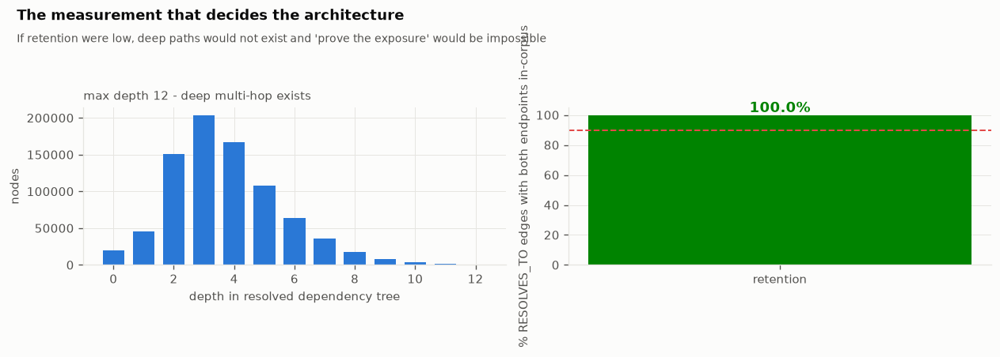

---

## 2. Shape

| Quantity | Value |
|---|---|
| In-degree power-law exponent (MLE) | alpha = 1.957 |
| Clauset bootstrapped goodness-of-fit | p = 0.0, power law rejected |
| Packages in a dependency cycle | 10,034 (in 2,366 cycles) |
| Is the graph a DAG | No |
| Longest dependency chain | 28 hops |
| Effective diameter (p90 sampled) | 16 |
| Largest weakly connected component | 1,219,685 packages (27.3 percent) |

**Meaning.** The graph has a heavy tail: a small number of packages carry the ecosystem.
Thus the criticality analysis looks at the head and does not sample uniformly. Deep
transitive paths exist (a 28-hop chain, a p90 effective diameter of 16). Thus "prove the
exposure with a path" is a real problem, not a one-hop lookup. The graph is not acyclic,
because declared dependencies can be circular.

**Limits.** Many publications call dependency graphs "scale-free". The strict Clauset
test **rejects** a pure power law (p = 0.0 for in-degree and out-degree). With a tail of
285,674 packages, the test rejects almost all real distributions. Thus the result is
"heavy tail, the head is dominant", not "scale-free". A lognormal or a power law with an
exponential cutoff is a better description. At this scale, we cannot find which one, and
the other analyses do not need it.

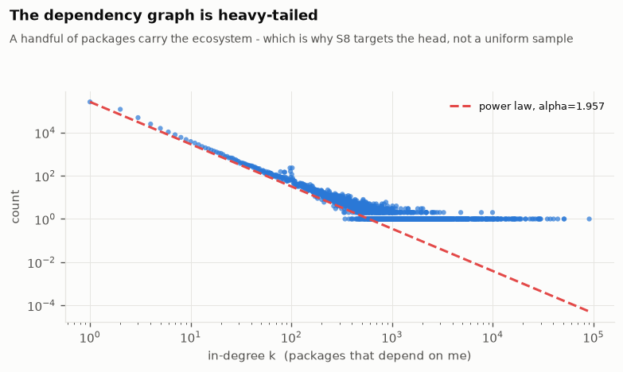
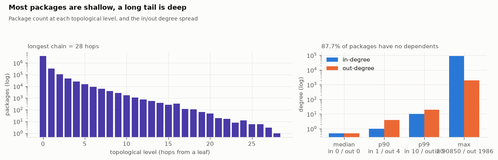

---

## 3. Structural criticality

| Quantity | Value |
|---|---|
| Articulation points | 88,273 (2.0 percent of packages) |
| Bridges | 386,554 |
| Spearman(in-degree, reverse PageRank) | -0.13 |
| Spearman(betweenness, reverse PageRank) | -0.06 |

**Meaning.** 88,273 packages are cut vertices. If you remove one, part of the graph
disconnects, because no path goes around it. The cut vertices with the most dependents
are `lodash`, `react`, `chalk`, `request`, `commander`, `express`, `react-dom`, `moment`,
`fs-extra`, `debug`. An engineer expects this list.

**Limits.** The centrality measures disagree. In-degree (popularity) and reverse PageRank
(systemic position) have a Spearman correlation of **-0.13**: almost no relation, with a
small negative correlation. There is no single "most central" ranking. Each measure shows
a different failure mode. A real triage list needs articulation points and bridges
together with PageRank.

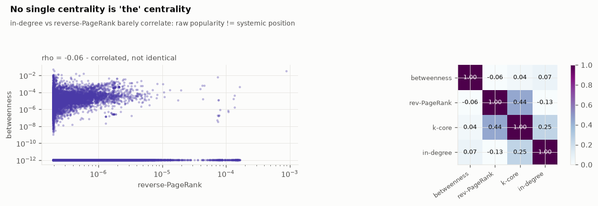

---

## 4. Systemic risk

| Quantity | Value |
|---|---|
| Reverse-PageRank Gini (connected core) | 0.262 |

**Meaning.** This is the xz-utils question at ecosystem scale: if one package is
compromised, how much is exposed? A Gini of 0.262 over the connected core shows that
systemic influence is concentrated, but not very much. A small set of packages carries
more than its share of the load.

**Limits.** The top of the raw reverse-PageRank ranking is npm spam: `all-of-them`,
`all-packages-143`, `wowdude-39`, `neat-133`. These packages depend on all packages, as a
joke or a stress test. The analysis marks this as an artefact, not a real result. For
this reason, the criticality analysis also uses articulation points and bridges. A
package that declares thousands of dependencies but has no dependents does not change
these measures.

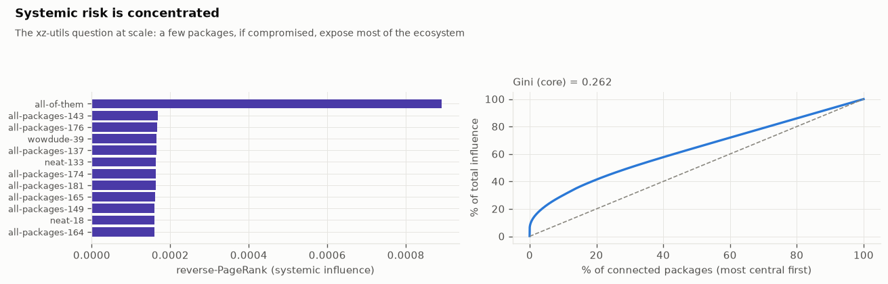

---

## 5. Change over time

| Quantity | Value |
|---|---|
| Densification exponent | a = 1.153 (R-squared 0.9977) |
| Mean degree, 2011 to 2020 | 3.0 to 5.9 |
| Preferential-attachment kernel slope | 0.936 |
| Community modularity Q | 0.518 |
| Fraction of edges between communities | 5.2 percent |

**Meaning.** The dependency graph becomes denser: `|E|` grows as `|V|` to the power
1.153. Each new group of packages depends on more existing packages than the group
before. This confirms the Leskovec-Kleinberg-Faloutsos densification law on real software
supply-chain data. New edges attach approximately in proportion to the existing in-degree
(kernel slope 0.936). This is the linear Barabasi-Albert model, not "winner takes all".
The graph has real community structure (Q = 0.518, much more than 0.3). Only 5.2 percent
of edges go between communities.

**Limits.** Each community has one ecosystem. The communities divide along npm, NuGet,
Maven, Packagist, PyPI, Cargo, and RubyGems lines. They do not make tool families across
ecosystems. This is the expected result, because there are almost no resolved edges
between ecosystems. The modularity number shows real structure, but most of that
structure is "npm is not PyPI".

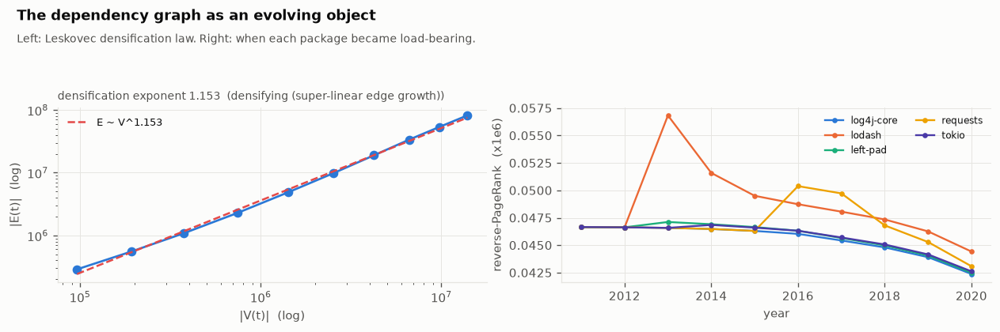
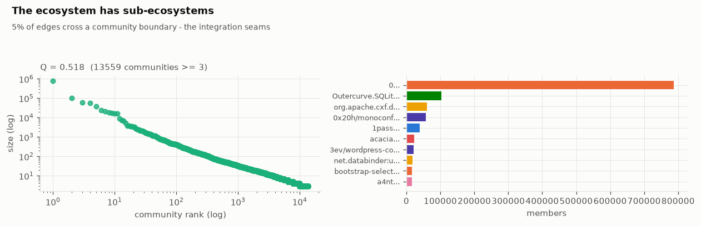
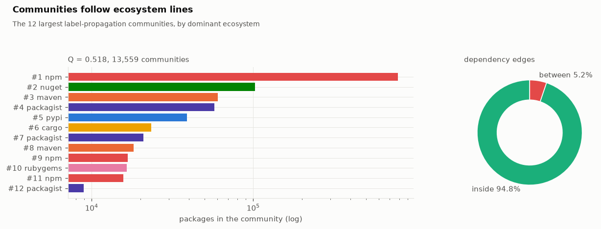

---

## 6. Remediation

| Quantity | Value |
|---|---|
| Exposed manifests | 2,177 |
| Manifests with a remediation | 641 |
| Manifests with a package that has no safe fix | 2,105 |
| Manifests that need a major bump | 367 |
| Advisories cleared by the greedy fixes | 2,334 |
| Advisories introduced by the greedy fixes | 317 |
| Manifests that become worse | 28 |
| Total CVSS mass, before to after | 139,316.6 to 128,519.5 |

**Meaning.** For most exposed manifests, the published version history does not support
"only upgrade": **2,105 of 2,177** contain one or more packages with no advisory-free
version, at or above the current version, without a major bump. The integer program shows
this. A greedy solver selects a compromise and does not tell you.

**Limits.** The fixes that exist are also not clean. Across the 641 manifests with a fix,
the greedy bumps **introduce 317 new advisories** (the new version is in the range of a
different advisory). **28 manifests become worse**, for example
`rubygems/refinerycms-pods@2.1.1`: 7 advisories cleared, 15 introduced. A remediation is a
graph edit, and you must evaluate it on the two sides of the edit. `whatif.diff_manifest`
does this.

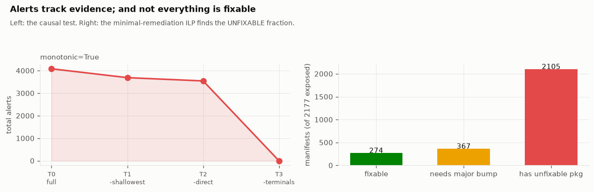

---

## 7. The alert ladder and reachability

| Quantity | Value |
|---|---|
| Counterfactual ablation curve (T0 to T3) | 4,084, 3,691, 3,545, 0 |
| Ablation monotonic | Yes |
| Structural over-claim compared with explicit version lists | Approximately 1 percent |
| Reachability prior: reachable / undetermined / unreachable | 20 percent / 79 percent / 0.6 percent |
| Alerts, without gate 7 to with the reachability prior | 9,853 to 9,789 |

**Meaning.** The alert count decreases at each tier, to zero, when the affected
terminals are removed from the graph in nested tiers. Alerts follow the evidence.
Structural "in range" over-claims real exposure by only approximately 1 percent, where a
tighter explicit list is available for a check.

**Limits.** The structural reachability prior almost does not change the alert count
(9,853 to 9,789). It is conservative by design and gives `undetermined` for 79 percent of
pairs. Useful reachability gates need a real static call-graph analysis. That analysis
runs on a GPU, and its precision is different for each ecosystem. The property "the
system does not alert on an item that it cannot trace" is real. The reachability filter
on top of it is weak at this time.

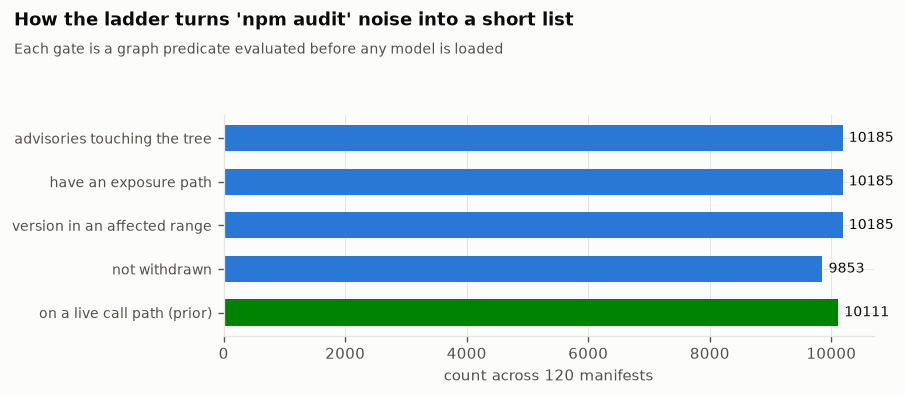
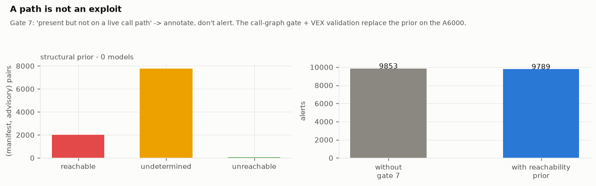

---

## 8. The model layer

| Signal | Result | Baseline or control |
|---|---|---|
| Semantic relevance (BGE-small, real compared with same-ecosystem control) | AUROC 0.955 | Control mean cosine 0.578, real 0.731 |
| Temporal GraphSAGE, CVE-risk node classification | AUROC 0.80, AP 0.10 | Logistic regression AUROC 0.75; gradient boosting 0.74 |
| GraphSAGE compared with best tabular, bootstrapped AP difference | +0.013, 95 percent CI [0.005, 0.021] | Interval is above 0 |
| Advisory-text severity check (Qwen3-14B, oracle) | 0.875 band accuracy | 0.53 constant predictor; 0.40 blind |

**Meaning.** Advisory text has sufficient package identity to select the affected package
over a different package of the same ecosystem (AUROC 0.955). A graph neural network
trained with a strict temporal split is better than the same features in a non-graph
model, with a confidence interval above zero. The judge model finds the CVSS band from the
vector string. Thus it is a valid measurement instrument for the severity check.

**Limits.** The semantic-relevance AUROC is **partly lexical overlap**: advisory summaries
name the package ("Prototype Pollution in lodash"). Thus it does not show understanding
of the vulnerability mechanism. The GraphSAGE advantage is real but **very small**: the
AP interval is [0.005, 0.021], only just above zero. This agrees with the usual result on
dependency graphs: the structural features already contain most of the neighbourhood
signal. The judge is validated only as an instrument for one task. It is not in the alert
path.

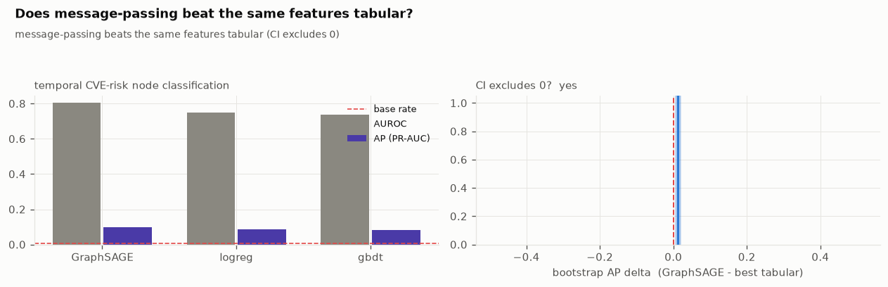

---

## 9. External validation

| Comparison | Result |
|---|---|
| Resolver fidelity compared with deps.dev (in-snapshot) | 97.2 percent agreement |
| Compared with `osv-scanner` over 150 generated lockfiles | 96.9 percent agreement |

**Meaning.** When the deps.dev version is also in the January 2020 snapshot, the
`scgraph` resolver selects the same version **97.2 percent** of the time (npm 97.6
percent, Cargo 100 percent). Against `osv-scanner`, the reference OSV client, over 150
lockfiles made from the graph, the two tools agree on **96.9 percent** of findings: 1,748
common, 45 only from `scgraph` (deeper transitive resolution and alias mapping), 10 only
from `osv-scanner` (advisories that `scgraph` gates out as withdrawn or out of range).

**Limits.** The raw resolver agreement is only 9.3 percent, because the 2020 snapshot
does not contain the versions after 2020 that deps.dev selects. This is a data-coverage
limit, not a resolver bug. The in-snapshot limit isolates the logic. The `osv-scanner`
comparison does not claim better recall. `scgraph` is a governance layer that gates on
provenance. Most disagreements show the gates operating as designed.

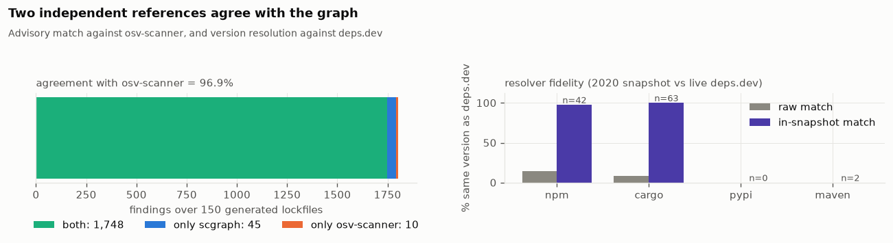

---

## 10. Performance

| Quantity | Value |
|---|---|
| CSR store build from Parquet | Approximately 2.3 minutes (`osv.materialise` 28 s + `kgstore.build` 140 s) |
| KGStore load for each process | 13.2 s, 16 GB peak resident set |
| Full-audit latency (ground, paths, 7-gate ladder) | p50 0.02 ms, p90 0.97 ms, p99 6.8 ms |
| Throughput | 2,546 full audits each second, one process |
| Reverse PageRank (40 iterations) on the package graph | 4.3 s |
| Articulation points and bridges | 7.5 s |
| k-core | 3.8 s |
| Label propagation | 216 s |
| Sampled betweenness | 166 s (reached the 150 s budget, used the fallback) |

**Meaning.** The numbers support the CSR memmap store (not a graph database): a full audit
takes a median of 0.02 milliseconds in the process. One Neo4j network round trip takes one
to five milliseconds. Edge samples from 2 percent to 100 percent of the package graph show
almost linear scaling for k-core, PageRank, articulation points, and connected components
([`scaling.json`](../results/metrics/scaling.json)).

**Limits.** Betweenness does not stay in the budget, and it uses a smaller sample on the
20-core. Label propagation (216 seconds) is the slowest of the practical algorithms. The
interactive numbers (audits each second) are for the query path. The batch graph
algorithms take minutes. This is acceptable, because they run one time for each corpus
update.

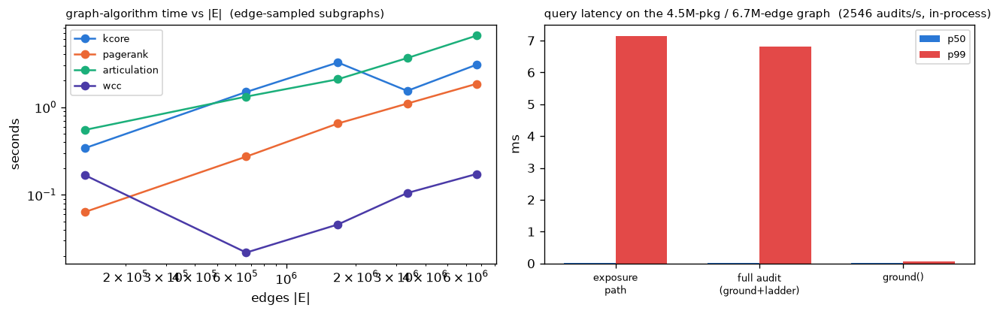

---

## 11. Coordination

| Run | Alerts | Advisories cleared | No fix |
|---|---|---|---|
| One-pass | 12,717 | 273 | 4,432 |
| Coordinated | 12,316 | 178 | 4,406 |

**Meaning.** We ran the coordinated multi-agent run (a reachability analyst gates the
patch proposer, a build verifier sends back breaking major bumps, an escalator handles the
items with no fix) against the one-pass pipeline on the same manifests.

**Limits.** **No clear win.** Coordination decreases alerts a little (12,717 to 12,316)
and clears fewer advisories (273 to 178). It gives less coverage for a small increase in
precision. We built and measured the multi-agent architecture. We do not assume that it
helps.

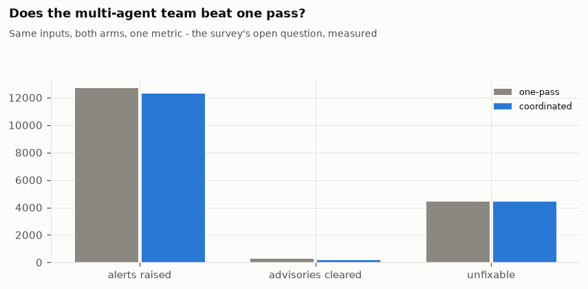

---

## 12. Advisory feed over time

| Quantity | Value |
|---|---|
| Mean CVSS base score (all advisories) | 6.92 |
| Advisories published in 2025 / 2026 | 197,809 / 31,365 |

**Meaning.** The advisory publication rate increased quickly. Most of the increase is
malware advisories (prefix `MAL-`) that name removed packages. The mean CVSS for each
publication year stays between approximately 5.8 and 7.9, with no clear upward trend.

**Limits.** The advisory counts of recent years are not comparable with the counts before
2022. They are a different type of record (automated malware disclosure, not curated
CVEs). The grounder ignores the names of removed packages. Thus they do not increase the
alerts. But "advisories each year" is not a clean measure.

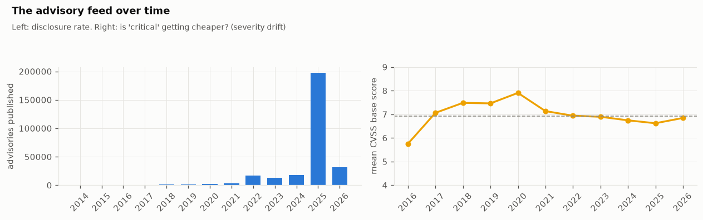

---

## 13. Summary scorecard

The short version, from [`scorecard.json`](../results/scorecard.json):

| Metric | Value |
|---|---|
| Graph scale | 21,415,461 versions / 4,460,049 packages / 82,807,953 resolved edges |
| In-degree power law (Clauset GoF) | alpha 1.957, p = 0.0, power law rejected |
| Packages in a dependency cycle | 10,034 |
| Articulation points / bridges | 88,273 / 386,554 |
| Reverse-PageRank Gini (core) | 0.262 |
| Densification exponent | 1.153 |
| Community modularity Q | 0.518 |
| Ablation monotonic (causal test) | True |
| Resolver fidelity (in-snapshot, compared with deps.dev) | 97.2 percent |
| Structural over-claim compared with explicit lists | Approximately 1 percent |
| Reachability prior: alerts removed | 9,853 to 9,789 |
| Exposed manifests with a package that has no fix | 2,105 / 2,177 |
| Remediation: advisories introduced by fixes | 317 |
| Semantic relevance AUROC (real compared with control) | 0.955 |
| GNN compared with tabular (AP difference CI excludes 0) | Yes |
| Instrument check (judge oracle compared with baseline) | 0.875 compared with 0.53, instrument valid |
| Compared with osv-scanner | Both 1,748, only `scgraph` 45, only scanner 10 |
| Full-audit latency p50 / throughput | 0.02 ms / 2,546 each second |

Refer to [evaluation.md](evaluation.md) for how we measure each number and its weak
points. Refer to [methodology.md](methodology.md) for the methods.
